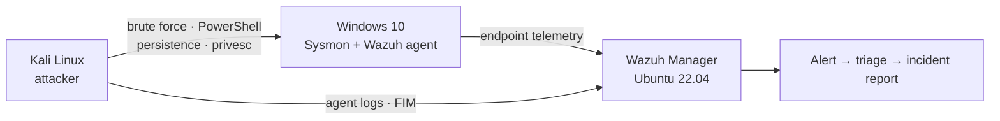

<div align="center">

<br/>

<a href="https://git.io/typing-svg">
  
</a>

<br/>

</div>

---

## 🐱 About Me

<p>Cybersecurity undergraduate and aspiring SOC Tier 1 analyst who builds real SOC environments rather than just studying them. Hands-on with SIEM deployment, Windows endpoint telemetry, attack simulation and structured incident reporting, and focused on alert triage, log correlation and detection engineering. Looking to join a blue team that values analysts who ask "why" before closing a ticket.</p>

<div align="center">


</div>

```bash
┌──(kripy17㉿blue-team)-[~/]
└─$ cat about.txt

  name        : Krish Patel
  alias       : kripy17
  location    : India 🇮🇳
  role        : Cybersecurity Undergraduate → Aspiring SOC Analyst
  focus       : Threat Detection · Incident Response · Detection Engineering
  hands-on    : Wazuh · Sysmon · Sigma
  in projects : Suricata · Nmap (BeyondLabs)
  learning    : Splunk · Microsoft Sentinel
  frameworks  : MITRE ATT&CK · NIST IR
  status      : 🟢 Actively seeking SOC opportunities

  motto       : "If it logs, I'll analyze it.
                 If it threatens, I'll detect it.
                 If it breaches — that's what playbooks are for."
                 (Spoiler: it won't breach. Probably.)
```

---

## 🏅 `> cat certifications.log`

> *"Certified to detect what others miss, and humble enough to keep learning."*

<div align="center">

<table>
<tr>
<td align="center" width="25%">

**🛡️ Google Cybersecurity**<br/>
`Professional Certificate`

<br/>

<a href="https://www.credly.com/badges/5fc52775-44d0-4d70-bd1a-972e97bc8bda/"></a>

</td>
<td align="center" width="25%">

**💻 Google IT Support**<br/>
`Professional Certificate`

<br/>

<a href="https://www.coursera.org/account/accomplishments/professional-cert/6HNPDKTJ01BQ"></a>

</td>
<td align="center" width="25%">

**🔐 CompTIA Security+**<br/>
`SY0-701`

<br/>


</td>
<td align="center" width="25%">

**🎯 TryHackMe**<br/>
`SOC Level 1 Path`

<br/>

<a href="https://tryhackme.com/p/kri.py17"></a>

</td>
</tr>
</table>

</div>

---

## 🏗️ `> ls ~/projects` — Featured Work

### 🛡️ [SOC Home Lab: End-to-End Security Operations Center](https://github.com/kripy17/SOC-Home-Lab)

> *"Built a SOC lab so realistic, even my home network started filing incident reports."*

A multi-phase, self-directed blue-team lab covering SIEM deployment, Windows endpoint monitoring, live attack simulation and structured incident investigation, built on consumer hardware with every engineering tradeoff documented.

**📄 Proof of work:** [5 written incident reports and full lab documentation](https://github.com/kripy17/SOC-Home-Lab) <!-- TODO: point this at the exact incident-reports folder or one sample report -->

| Phase | Focus Area | Status |
|:--|:--|:--|
| Phase 1: SIEM Infrastructure | Wazuh deployment · Kali onboarding · Log pipeline · FIM · Attack simulation | ✅ Complete |
| Phase 2: Windows + Sysmon | Windows agent · SwiftOnSecurity config · Process telemetry · Wazuh integration | ✅ Complete |
| Phase 3: Attack Simulation | Brute force · PowerShell abuse · Persistence · Privilege escalation · 5 incident reports | ✅ Complete |

`Wazuh · Ubuntu 22.04 · Kali Linux · Windows 10 · Sysmon · VMware · UFW`

<a href="https://github.com/kripy17/SOC-Home-Lab"></a>

### 🔬 [BeyondLabs: Local-First SOC Workbench](https://github.com/kripy17/BeyondLabs)

> *"A workbench where every tool is honest, every result is evidence-backed, and nothing is faked."*

A local-first workbench for defensive analysts: artifact intake, phishing triage, SIEM log review and detection engineering in one app, all on your own machine. Strict no-fake-output philosophy: if a dependency is missing, you're told, not deceived.

| Category | Workspaces |
|:--|:--|
| 🔍 Triage & Analysis | Artifact Intake · Phishing Triage · Safe URL Analysis · Attachment Triage |
| 🚨 SIEM, Detection & Alerts | SIEM Workspace · Logs & Alerts · Detection Engineering · MITRE ATT&CK · IDS Alerts |
| 🛠️ Recon & Toolkit | Recon & OSINT · Nmap Runner · Hacking Toolkit · CyberChef |
| 📄 Reference & Reporting | SOC Guide · Case & Report |

`React · Vite · TypeScript · FastAPI · Python · Linux / macOS / Windows`

<a href="https://github.com/kripy17/BeyondLabs"></a>

---

## 🛡️ `> ./lab_topology.sh --show`

How the [SOC Home Lab](https://github.com/kripy17/SOC-Home-Lab) pipeline runs, from attack to incident report:



**ATT&CK coverage (highlights)**

| Tactic | Behavior simulated / detected | Where |
|:--|:--|:--|
| Credential Access | Brute force (T1110) | SOC Home Lab, Phase 3 |
| Execution | PowerShell abuse (T1059.001) | SOC Home Lab, Phase 3 |
| Persistence | Persistence mechanisms | SOC Home Lab, Phase 3 |
| Privilege Escalation | Privilege escalation | SOC Home Lab, Phase 3 |
| Defense Evasion | Rundll32 proxy execution (T1218.011) | Sigma rule below |

---

## 🧬 `> cat detections/rundll32.yml`

<details>
<summary><b>Sigma sample:</b> suspicious rundll32 execution (T1218.011)</summary>

```yaml
title: Suspicious Rundll32 Execution via Non-Standard Export
status: experimental
description: >
  Detects rundll32.exe invoked with export/argument patterns commonly used
  to proxy execution through a trusted Windows binary (LOLBin abuse).
references:
    - https://attack.mitre.org/techniques/T1218/011/
tags:
    - attack.defense_evasion
    - attack.t1218.011
logsource:
    category: process_creation
    product: windows
detection:
    selection:
        Image|endswith: '\rundll32.exe'
        CommandLine|contains:
            - 'javascript:'
            - '.dll,#'
            - 'shell32.dll,Control_RunDLL'
    condition: selection
falsepositives:
    - Legitimate Control Panel applet launches via rundll32 (rare in this exact form)
level: medium
```

<sub>Illustrative: written to demonstrate rule structure and MITRE mapping style, not pulled from a specific production incident.</sub>

</details>

<details>
<summary><b>SOC investigation workflow:</b> how I approach an alert</summary>

<br>

```
01  VALIDATE     Confirm alert authenticity, cut the noise
02  CORRELATE    Cross-reference logs across data sources
03  IOC HUNT     Extract IPs, hashes, domains, artifacts
04  ATT&CK MAP   Map activity to MITRE techniques
05  SCOPE        Determine blast radius & affected assets
06  CONTAIN      Recommend isolation & remediation actions
07  DOCUMENT     Write a clear, structured incident report
```

*Step 8 (unofficial): Drink coffee. Repeat.*

</details>

---

## ⚔️ `> cat inventory.txt` — Skill Tree

<div align="center">

**🖥️ Detection & Endpoint (hands-on)**


**🔧 Used in projects (BeyondLabs)**


**🧠 Frameworks**


**💻 Languages & Tooling**


**⚙️ OS, Virtualisation & Dev**


**📚 Learning**


</div>

---

## 📊 `> ./evidence --counted`

<div align="center">

| Evidence | Count |
|:--|:--:|
| 📄 Incidents documented | **5** |
| 🗺️ MITRE techniques mapped | **8** |
| 🧪 Attacks simulated | **5** |
| 🧰 Workspaces built (BeyondLabs) | **16** |
| 🚨 Alerts generated in lab | **68** |

<sub>Sourced from <a href="https://github.com/kripy17/SOC-Home-Lab">SOC Home Lab</a> and <a href="https://github.com/kripy17/BeyondLabs">BeyondLabs</a>. Not aspirational, just counted.</sub>

</div>

---

## 🎯 `> cat current_quests.log`

```diff
+ [ACTIVE]    📚 Studying: CompTIA Security+ (SY0-701)
+ [ACTIVE]    🔬 Building: BeyondLabs, local-first SOC workbench
+ [ACTIVE]    🎯 Practicing: TryHackMe SOC Level 1 Path
+ [ACTIVE]    📖 Reading: MITRE ATT&CK technique docs (yes, for fun)
- [LOCKED]    👑 Boss Fight: Land my first SOC Analyst role
```

---

## 🏙️ `> ./render_skyline.sh --3d`

<div align="center">

<!-- Generated by .github/workflows/profile-3d.yml; shows up after the workflow has run once -->


<br/>


</div>

---

## 🎓 Education

- B.Sc. Computer Science (Cybersecurity), MIT World Peace University, Pune

---

## 📡 `> ping --connect`

<div align="center">

<i>Always happy to talk SOC, blue team, or detection engineering.<br/>If you've got an interesting alert to investigate, my DMs are open.</i>

<br/>

<a href="https://www.linkedin.com/in/kripy17/"></a>
<!-- EMAIL: replace YOUR_EMAIL_HERE, then delete this comment's start/end markers to enable
<a href="mailto:YOUR_EMAIL_HERE"></a>
-->
<!-- RESUME: upload Krish_Patel_Resume.pdf to this repo, then delete this comment's start/end markers to enable
<a href="./Krish_Patel_Resume.pdf"></a>
-->
<a href="https://github.com/kripy17"></a>
<a href="https://tryhackme.com/p/kri.py17"></a>

<br/><br/>

```bash
┌──(kripy17㉿blue-team)-[~/]
└─$ logout

  session       : terminated
  status        : 🟢 open to SOC Analyst opportunities

$ echo "all threats investigated · no logs left unread · coffee consumed."
$ exit 0   # GAME OVER? Nah. INSERT COIN TO CONTINUE 🪙
```


</div>
