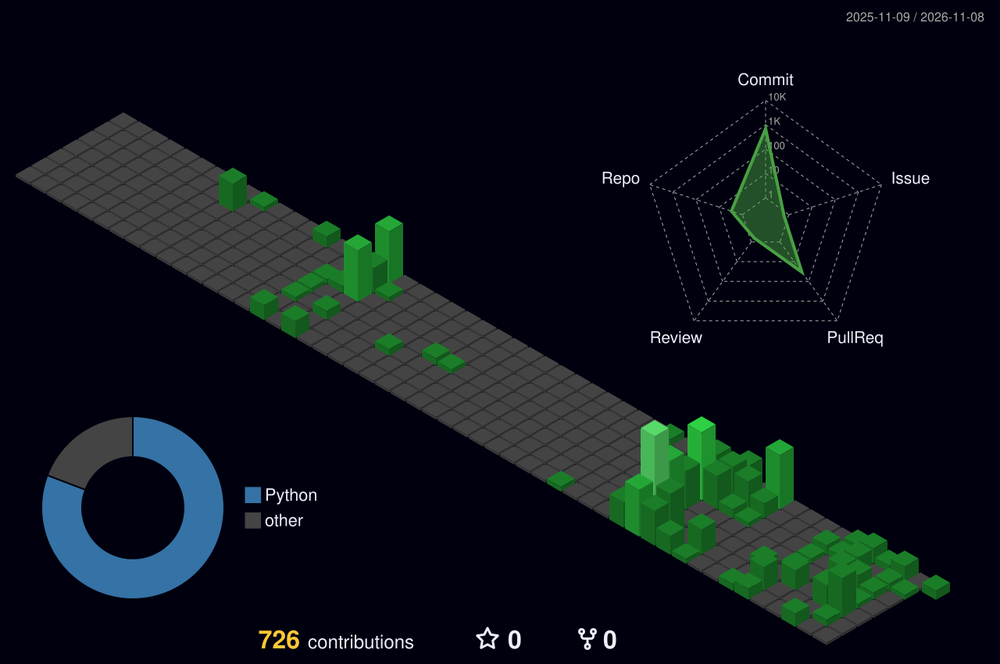
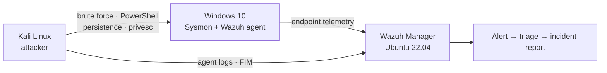

<div align="center">

<!-- Animated Living Identity Banner -->

<br/>

<a href="https://git.io/typing-svg">
  
</a>

<br/>


</div>

---

## 🐱 About Me

<p>Cybersecurity undergraduate and aspiring SOC Tier 1 analyst who builds real SOC environments rather than just studying them. Hands-on with SIEM deployment, Windows endpoint telemetry, attack simulation and structured incident reporting, and focused on alert triage, log correlation and detection engineering. Looking to join a blue team that values analysts who ask "why" before closing a ticket.</p>

<div align="center">


</div>

```bash
┌──(kripy17㉿blue-team)-[~/]
└─$ cat about.txt

  name        : Krish Patel
  alias       : kripy17
  location    : India 🇮🇳
  role        : Cybersecurity Undergraduate → Aspiring SOC Analyst
  focus       : Threat Detection · Incident Response · Detection Engineering
  tools       : Wazuh · Splunk · Microsoft Sentinel · Suricata · Sysmon
  frameworks  : MITRE ATT&CK · NIST IR
  status      : 🟢 Actively seeking SOC opportunities
```

## ⚔️ `> cat inventory.txt` — Skill Tree

<div align="center">

**🖥️ SIEM & Detection**


**🌐 Network Monitoring**


**🔎 Endpoint & Log Analysis**


**🧠 Frameworks & Standards**


**💻 Languages & Tooling**


**⚙️ OS, Virtualisation & DevOps**


</div>

---

## 📊 `> ./stats --player=kripy17`

<div align="center">


</div>

---

## 🏆 `> unlock --achievements`

<div align="center">


</div>

---

## 🏙️ `> ./render_skyline.sh --3d`

<div align="center">

<!-- Generated by .github/workflows/profile-3d.yml; shows up after the workflow has run once -->


</div>

---

## 🎯 `> cat current_quests.log`

```diff
+ [ACTIVE]    📚 Studying: CompTIA Security+ (SY0-701)
+ [ACTIVE]    🔬 Building: BeyondLabs, local-first SOC workbench
+ [ACTIVE]    🎯 Practicing: TryHackMe SOC Level 1 Path
+ [ACTIVE]    📖 Reading: MITRE ATT&CK technique docs (yes, for fun)
! [PENDING]   🛡️ Goal: Detection engineering with real-world telemetry
- [LOCKED]    👑 Boss Fight: Land my first SOC Analyst role
```

<div align="center">

| 🕹️ Stat | ▰▰▰▰▰▰▰▰▰▰ | Count |
|:--|:--|:--|
| 🧪 Attacks Simulated | `██████████` | **5** |
| 🚨 Alerts Generated | `██████████` | **68** |
| 📄 Incidents Documented | `██████████` | **5** |
| 🗺️ MITRE Techniques Mapped | `██████████` | **8** |
| 🧰 Workspaces Built | `██████████` | **16** |
| ☕ Caffeine | `██████████` | **MAX** |

<sub>Sourced from <a href="https://github.com/kripy17/SOC-Home-Lab">SOC Home Lab</a> and <a href="https://github.com/kripy17/BeyondLabs">BeyondLabs</a>. Not aspirational, just counted.</sub>

</div>

---

## 🛡️ `> ./lab_topology.sh --show`

How the [SOC Home Lab](https://github.com/kripy17/SOC-Home-Lab) pipeline runs, from attack to incident report:



**ATT&CK coverage (highlights)**

| Tactic | Behavior simulated / detected | Where |
|:--|:--|:--|
| Credential Access | Brute force (T1110) | SOC Home Lab, Phase 3 |
| Execution | PowerShell abuse (T1059.001) | SOC Home Lab, Phase 3 |
| Persistence | Persistence mechanisms | SOC Home Lab, Phase 3 |
| Privilege Escalation | Privilege escalation | SOC Home Lab, Phase 3 |
| Defense Evasion | Rundll32 proxy execution (T1218.011) | Sigma rule below |

---

## 📡 `> ping --connect`

<div align="center">

<a href="https://github.com/kripy17"></a>
<a href="https://www.linkedin.com/in/kripy17/"></a>
<a href="https://tryhackme.com/p/kri.py17"></a>

<br/><br/>

```bash
┌──(kripy17㉿blue-team)-[~/]
└─$ logout

  session       : terminated
  status        : 🟢 open to SOC Analyst opportunities
  fp_rate       : very low (I promise)

$ echo "all threats investigated · no logs left unread · coffee consumed."
$ exit 0   # GAME OVER? Nah. INSERT COIN TO CONTINUE 🪙
```


</div>

<p align="center"><sub>KRISH PATEL · kripy17</sub></p>

## Certifications

- **CompTIA Security+ (SY0-701)** · In progress
- **Google Cybersecurity Professional Certificate** · Completed · [Credly badge](https://www.credly.com/badges/5fc52775-44d0-4d70-bd1a-972e97bc8bda/)
- **Google IT Support Professional Certificate** · Completed · [Coursera](https://www.coursera.org/account/accomplishments/professional-cert/6HNPDKTJ01BQ)
- **TryHackMe SOC Level 1 Path** · In progress · [Profile](https://tryhackme.com/p/kri.py17)

## Projects

**[SOC Home Lab, End-to-End Security Operations Center](https://github.com/kripy17/SOC-Home-Lab)**
- Multi-phase, self-directed blue-team lab: SIEM infrastructure, Windows endpoint monitoring, live attack simulation and structured incident investigation, built on consumer hardware with every tradeoff documented.
- Phase 1: Wazuh deployment, Kali onboarding, log pipeline, FIM, attack simulation.
- Phase 2: Windows agent, SwiftOnSecurity Sysmon config, process telemetry, Wazuh integration.
- Phase 3: brute force, PowerShell abuse, persistence, privilege escalation, 5 incident reports.
- Stack: Wazuh · Ubuntu 22.04 · Kali Linux · Windows 10 · Sysmon · VMware · UFW

**[BeyondLabs, Local-First SOC Workbench](https://github.com/kripy17/BeyondLabs)**
- Local-first workbench for defensive analysts: artifact intake, phishing triage, SIEM log review and detection engineering in one app. Strict no-fake-output philosophy: if a dependency is missing, you're told, not deceived.
- Workspaces: Artifact Intake · Phishing Triage · Safe URL Analysis · Attachment Triage · SIEM Workspace · Logs & Alerts · Detection Engineering · MITRE ATT&CK · IDS Alerts · Recon & OSINT · Nmap Runner · Hacking Toolkit · CyberChef · SOC Guide · Case & Report
- Stack: React · Vite · TypeScript · FastAPI · Python · Linux / macOS / Windows

<details>
<summary><b>Detection engineering sample</b>: suspicious rundll32 execution (T1218.011)</summary>

```yaml
title: Suspicious Rundll32 Execution via Non-Standard Export
status: experimental
description: >
  Detects rundll32.exe invoked with export/argument patterns commonly used
  to proxy execution through a trusted Windows binary (LOLBin abuse).
references:
    - https://attack.mitre.org/techniques/T1218/011/
tags:
    - attack.defense_evasion
    - attack.t1218.011
logsource:
    category: process_creation
    product: windows
detection:
    selection:
        Image|endswith: '\rundll32.exe'
        CommandLine|contains:
            - 'javascript:'
            - '.dll,#'
            - 'shell32.dll,Control_RunDLL'
    condition: selection
falsepositives:
    - Legitimate Control Panel applet launches via rundll32 (rare in this exact form)
level: medium
```

<sub>Illustrative: written to demonstrate rule structure and MITRE mapping style, not pulled from a specific production incident.</sub>

</details>

<details>
<summary><b>SOC investigation workflow</b>: how I approach an alert</summary>

<br>

```
01  VALIDATE     Confirm alert authenticity, cut the noise
02  CORRELATE    Cross-reference logs across data sources
03  IOC HUNT     Extract IPs, hashes, domains, artifacts
04  ATT&CK MAP   Map activity to MITRE techniques
05  SCOPE        Determine blast radius & affected assets
06  CONTAIN      Recommend isolation & remediation actions
07  DOCUMENT     Write a clear, structured incident report
```

*Step 8 (unofficial): Drink coffee. Repeat.*

</details>

## Education

- B.Sc. Computer Science (Cybersecurity), MIT World Peace University, Pune
